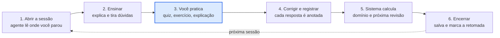

# SAC — Sistema de Aprendizagem Contínua

Um **professor particular que anota tudo**. Você abre esta pasta em um agente de IA (Claude Code, Antigravity ou qualquer um que leia `AGENTS.md`) e estuda uma disciplina conversando. O agente explica, tira dúvidas, faz perguntas, corrige e agenda revisões. Um programa em Python guarda o que precisa ser exato: horários reais, nível de domínio e data da próxima revisão.

> **Nunca usou? Comece pelo [MANUAL.md](MANUAL.md).** Ele foi escrito para quem não é programador: tem analogias, cenários, dúvidas frequentes e frases prontas. Este README é só a versão rápida.

## A ideia em 30 segundos

| Peça | Analogia | O que faz |
|---|---|---|
| Agente de IA | O professor particular | Explica, pergunta e corrige |
| Registro (`eventos.jsonl`) | O caderno de anotações | Guarda cada resposta sua, com data e hora. Só se acrescenta, nada se apaga |
| `scripts/sac.py` | O secretário | Carimba a hora, calcula domínio e revisões, confere se gravou |
| Painel | A recepção com botões | Mostra o que fazer agora, sem digitar comandos |

**Quem lembra é o caderno, não o modelo.** Se a conversa cair, o agente lê o registro e retoma de onde você parou.

## Fluxo de uma sessão



**Só o que você pratica entra no registro de progresso.** Ler uma explicação ou pedir um resumo ajuda, mas não muda seu nível, assim como assistir a um vídeo de treino não conta como série feita.

## Começando

1. Instale o **Python 3.9+** (python.org; no Windows, marque *Add python.exe to PATH*). O `pdfinfo` (poppler) é opcional.
2. Abra esta pasta no seu agente e diga **"oi"**. Ele mostra um menu; responda com o número.
3. Crie a disciplina: *"Crie a disciplina Cálculo I"*.
4. Coloque os materiais em `disciplinas/<apelido>/01_FONTES/` e diga: *"Faça a ingestão dos materiais."*
5. Informe as datas de prova e diga **"vamos estudar"**. No fim: **"encerrar sessão"**.

Prefere botões? Dê duplo clique em `Abrir-Painel.bat` (Windows) ou `Abrir-Painel.command` (macOS; no Linux, `./Abrir-Painel.command`). O painel abre só neste computador.

> No Windows, onde a documentação mostra `python3`, use `python` ou `py`.
> No macOS/Linux, se o atalho não abrir: `chmod +x Abrir-Painel.command`.

## O que o agente faz

- Explica tópicos e responde perguntas, inclusive seguidas e fora do assunto.
- Gera resumos, mapas mentais, flashcards e listas de exercícios a partir dos seus materiais.
- Faz quizzes, corrige e registra o desempenho.
- Agenda revisões (1, 3, 7, 14, 30 e 60 dias) e calcula o risco de atraso antes das provas.
- Retoma de onde você parou, mesmo dias depois. Cada disciplina é uma pasta independente.

## Como o progresso é calculado

Feito por código, não pelo humor do modelo. Só conta tentativa **independente** (sem ajuda e que não seja mero reconhecimento).

| Estado | Regra resumida |
|---|---|
| Provisoriamente dominado | 3+ tentativas, média das 3 últimas ≥ 80%, ao menos uma de explicar/aplicar/transferir ≥ 80%, em 2+ questões distintas |
| Domínio consistente | O anterior + um acerto ≥ 80% pelo menos 7 dias depois |
| Revisão necessária | Revisão vencida, ou última tentativa < 50% |

Os limiares ficam em `disciplinas/<apelido>/config.json`. Detalhes e analogias no [manual, seção 6](MANUAL.md#6-como-o-progresso-funciona).

## Regras que o agente segue

Definidas em [`AGENTS.md`](AGENTS.md). As principais:

- **Nunca inventa** páginas, datas, notas, citações ou progresso. Sem dado, diz "desconhecido".
- **Só diz que salvou** se o programa imprimir `[verificado]`.
- **Não revela o gabarito** antes de você tentar, a menos que você peça.
- **Não apaga materiais nem altera datas oficiais** sem a sua autorização.

Mais em [MANUAL.md, seção 7](MANUAL.md#7-o-que-pode-o-que-não-deve-e-os-limites).

## Estrutura do projeto

```
AGENTS.md              regras permanentes do agente (CLAUDE.md e GEMINI.md apontam para ele)
COMECE-AQUI.md         guia curto para o estudante
MANUAL.md              manual completo para leigos
.agents/skills/        nove protocolos sob demanda (sessão, ingestão, ensino, avaliação...)
scripts/sac.py         CLI: único escritor do estado
scripts/sac_painel.py  painel local com botões
tests/test_sac.py      75 testes
disciplinas/<slug>/    seus dados; dados/eventos.jsonl é a fonte de verdade
```

## Comandos principais

Todos começam com `python3 scripts/sac.py`. Com mais de uma disciplina, acrescente `-d <apelido>`. Você não precisa decorá-los: o agente e o painel rodam tudo.

| Quero | Comando |
|---|---|
| O que fazer agora | `guia` |
| Situação, revisões e fontes novas | `briefing` |
| Fila de revisão / risco / relatório | `revisoes` · `risco` · `relatorio` |
| Criar disciplina | `nova <apelido> --nome "..."` |
| Iniciar / encerrar sessão | `sessao iniciar` · `sessao encerrar` |
| Conferir integridade | `validar` |

Lista completa no [apêndice do manual](MANUAL.md#10-apêndice-comandos).

## Dúvidas comuns

- **"Finalizar a disciplina" apaga algo?** Não. Só encerra a sessão; todo o histórico fica.
- **Ele só faz perguntas?** Por padrão tende a perguntar antes de explicar. Diga: *"Ensine primeiro, tire minhas dúvidas e só me teste quando eu pedir."*
- **Pode perguntar fora do assunto?** Pode. Ele deve avisar quando a resposta for conhecimento geral e não dos seus materiais.
- **Como trocar de disciplina?** Encerre a sessão atual e diga *"quero estudar [outra]"*.

Todas as respostas, com cenários e frases prontas, estão no [MANUAL.md](MANUAL.md).

## Limitações

- A qualidade das explicações e das correções depende do modelo. O código garante registro e cálculo, não que o conteúdo esteja certo. Para assunto de prova, confira nos seus materiais.
- Nada roda sozinho: sem lembretes e sem cronômetro. O tempo de estudo efetivo só existe se você declarar.
- Não há leitura de PDF embutida; o agente usa ferramentas do ambiente (como `pdftotext`).
- Testado principalmente em Linux. Windows, o painel em navegador real e o Antigravity não foram testados.

## Testes e backup

```
python3 -m unittest discover -s tests -v
```

**Faça backup (ou use git) da pasta `disciplinas/`.** O arquivo `eventos.jsonl` é todo o seu histórico.
